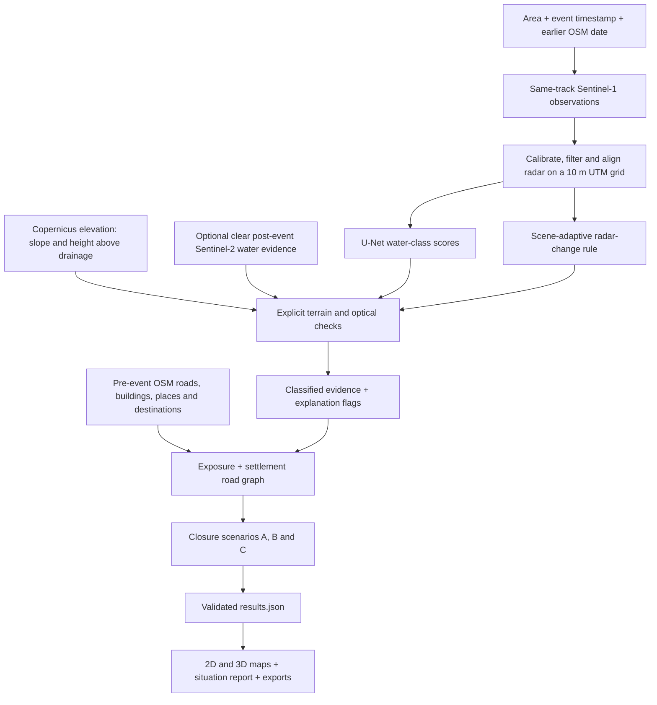

# Cutoff — Mapping Flood Exposure and Access from Space

**From satellite observations to flood evidence, exposed infrastructure and possible settlement isolation.**

A settlement can remain above the water and still lose its only road to a hospital or town. Cutoff connects satellite flood/change evidence with historical roads, buildings and settlements to help explain that loss of access.

Give the system an **area of interest, event timestamp and pre-event infrastructure date**. It produces an interactive before/after map, a 3D terrain view, infrastructure exposure summaries, three road-closure scenarios and downloadable geospatial evidence. It is intended for disaster analysts, district authorities, humanitarian logistics teams and researchers deciding what to investigate next.

Built for the **Multimodal AI Hackathon 2026, Track B**. This is an **educational prototype**: mapped exposure is not confirmed damage, and modeled road connectivity is not verified road passability.

## Contents

- [What users get](#what-users-get)
- [How the system works](#how-the-system-works)
- [Reading the maps](#reading-the-maps)
- [Models and measured results](#models-and-measured-results)
- [Case studies](#case-studies)
- [Installation and first run](#installation-and-first-run)
- [Running real analyses](#running-real-analyses)
- [Preparing imagery and terrain](#preparing-imagery-and-terrain)
- [Outputs and reproducibility](#outputs-and-reproducibility)
- [Training, evaluation and tests](#training-evaluation-and-tests)
- [Repository layout](#repository-layout)
- [Limitations and project status](#limitations-and-project-status)
- [Data attribution and licence](#data-attribution-and-licence)

## What users get

| Capability | What it helps answer |
|---|---|
| Dated before/after comparison | What did the same location look like in the earlier and later Sentinel-2 observations? |
| Classified flood and radar-change layers | Where does the analysis identify floodwater, possible flood or changed radar behavior? |
| Original radar and saved model scores | What observations and learned output support the interpretation? |
| Building and road exposure | Which mapped infrastructure intersects the evidence? |
| A/B/C road-access scenarios | Which settlements retain a mapped route to destinations under different closure assumptions? |
| 3D terrain, contours and source popups | How do valleys, ridges, source coordinates and road snapping affect the interpretation? |
| Optional downstream DEM trace | Where does a computed drainage route continue from a selected source? |
| Reports and geospatial downloads | What can an analyst inspect, share or load into GIS for further verification? |

The local dashboard uses a wide map workspace with top navigation for saved runs and new analyses. Access summaries, evidence explanations and results sit outside the map canvas. Searchable run history, settlement filtering, scenario switching, fullscreen maps and responsive layouts support overview and detailed inspection. Existing runs and their saved model outputs remain available when the presentation changes.

## How the system works



1. **Select comparable radar observations.** The post-event image must be strictly later than the event and compatible in orbit direction and relative track. Up to three earlier observations form the reference; insufficient coverage is rejected.
2. **Prepare a shared analysis grid.** Calibrated VV/VH backscatter is stored in linear units and filtered before analysis. Earlier observations are averaged in linear units. All analysis rasters share the same projected 10 m grid; invalid pixels remain missing rather than becoming artificial water.
3. **Combine independent evidence.** The released neural network predicts water classes. A separate robust change rule detects unusual radar decreases and increases. Terrain and available clear optical observations refine the final classes.
4. **Intersect historical infrastructure.** OSM must predate the event. Buildings, roads, settlements and destinations are acquired with dated cache provenance.
5. **Test access assumptions.** A noded road multigraph preserves parallel roads and grade separation. Baseline and post-closure routes are compared to mapped hospitals, clinics, health posts, towns and cities, including a 15 km routing buffer.
6. **Publish a traceable run.** Stage contracts validate outputs before the next stage. Results record dates, model version, processing mode, warnings and access assumptions, then drive the dashboard and situation report.

The implementation uses Python, rasterio/GDAL, GeoPandas/Shapely, PyTorch, segmentation-models-pytorch, NetworkX, pyflwdir and Pydantic. The dashboard is a local Python HTTP server with JavaScript/MapLibre maps. Reports use Jinja2 and WeasyPrint, with an xhtml2pdf fallback. Browser libraries are vendored locally.

## Reading the maps

### 2D: inspect one question at a time

The main map follows **Before → Flood extent → Downstream → Road access**. The comparison divider keeps the location aligned while changing observation date. AI prediction and additional evidence controls expose the original saved outputs.

| Appearance | Meaning | Interpretation |
|---|---|---|
| Dark blue water | Persistent-water classification or dated river/water context, as labelled | Existing water is separate from newly classified floodwater. |
| Strong blue patches | High-confidence flood class | Model evidence after configured interpretation checks; field verification remains necessary. |
| Pale blue patches | Possible flood | Lower-confidence interpretation, including terrain or optical contradictions. |
| Small blue locator dots | Tiny classified flood patches at overview scale | These locate ground patches; they are not settlement markers. |
| Yellow ground patches | Unusual radar decrease | Can indicate water or smooth wet mud; does not independently confirm flooding. |
| Red-brown ground patches | Unusual radar increase | A roughness change to investigate; does not independently establish debris or destruction. |
| Turquoise water | Separate optical-water observation | May include water that existed before the event. |
| Blue intensity in AI prediction | Saved flood-class score before final terrain/optical gating | A global model score, not a locally validated probability. |
| Grayscale background | Original radar intensity | Brightness is returned radar energy, not terrain height or water depth. |
| Optical stripes | Cloud, shadow, snow or unavailable optical context | Optical limitations differ from radar limitations. |
| Radar blind-spot hatching | Radar no-observation areas | Unavailable evidence does not imply safe ground. |
| Highlighted building polygons and roads | Mapped geometry overlapping evidence | Exposure does not prove damage, occupancy or affected population. |
| Red road lines | Road sections assumed closed under the selected policy | Scenario output, not observed destruction. |

Settlement circles describe **access**, using a separate legend:

| Circle | Status | Meaning |
|---|---|---|
| Green | Connected | A mapped route remains. |
| Amber | Degraded | A route remains, but modeled travel time exceeds 1.5 times the baseline. |
| Red | Cut off | No mapped route to the considered destinations remains under this scenario. |
| Grey | Unknown | No known baseline mapped connection is available. |

A red settlement can be outside the water because an affected road corridor is elsewhere on its route. Popups identify the source coordinates, road-node snapping distance, baseline/after travel time and evidence class at the marker. Named OSM places keep their mapped locations. Building-cluster markers use a point inside a real member footprint rather than an average that could lie in a river.

### Three road-closure scenarios

| Policy | Non-bridge roads | Bridges |
|---|---|---|
| **A — Conservative** | Close road pieces within 15 m of any hazard class 1–4. | Require high-confidence evidence at an approach. |
| **B — Sustained overlap** | Close pieces with at least 50 m inside high-confidence classes 1 or 4. | Require high-confidence evidence at an approach. |
| **C — Bridges only** | No non-bridge closures. | Close bridges where high-confidence evidence reaches an approach. |

Bridge checks use 25 m approach neighborhoods, avoiding closure simply because a bridge crosses normal river water. All three policies use the same satellite evidence. Their differences describe sensitivity to assumptions; they are not three measurements of confirmed road failure. Roads outside observed analysis coverage are assumed open, and incomplete OSM remains a limitation.

### 3D: understand the landform

The **3D terrain** presentation uses Copernicus GLO-30 elevation with wider context, hill shading and optional measured contours. Dated natural colour, original radar, model scores, flood, radar changes, assets, inferred closures, no-observation and downstream layers remain selectable.

- Height starts at **1× true vertical scale**. Enhanced 1.5×/2× relief is labelled.
- Prepared terrain uses a 40 km context buffer, native approximately 30 m source detail and 512-pixel Terrain-RGB tiles. A denser display mesh improves rendering without inventing finer elevation measurements.
- Contours use 20 m intervals for the reviewed Deir floodplain and 100 m for the reviewed Nepal terrain. Flat terrain is expected to remain comparatively flat.
- Buildings retain mapped footprints; surveyed building heights are unavailable.
- Missing elevation coverage is unavailable rather than replaced with zero-height cliffs.
- Reviewed runs include marker/road registration audits in `display/terrain.json`.

The optional flow trace follows D8 drainage directions on an expanded elevation surface, up to the configured 150 km cap. It appears cyan in 2D and orange in 3D. Animated particles indicate direction; they do not measure velocity, depth, sediment transport or arrival time. Nearby mapped places are not automatically affected places.

## Models and measured results

### Released flood network

The production checkpoint is **`models/cutoff_unet_v1.pt`**, a U-Net with a ResNet-34 encoder trained on Kuro Siwo. It predicts **no water, persistent water and flood** per valid pixel.

Its seven-channel interface contains before VV/VH, after VV/VH, changes in VV/VH and a slope slot. In the released `b3_no_slope` model, the slope slot stays at its training mean; the other six channels vary. Slope is interpreted explicitly outside the network so that coarse elevation around narrow valleys does not silently suppress possible flood detections. Overlapping 224-pixel tiles and weighted blending reduce inference seams.

The checkpoint records normalization, channel order, model/version metadata, temperature and decision threshold. The release uses threshold **0.50** and temperature approximately **1.037**. Experimental model-v2 is not the production default.

### Radar change and interpretation checks

A separate scene-adaptive rule estimates stable-terrain variability with robust statistics and finds unusual backscatter decreases/increases. It is independent of the network's flood score. Explicit checks use slope, height above nearest drainage and available clear optical water/dry-ground observations. Eight bit flags record interpretation reasons; radar shadow, layover and invalid observations get their own no-observation class. See the exact [class and flag contracts](docs/plan/05_contracts.md).

### Held-out benchmark

The represented Kuro Siwo subset contains **27 training events / 9,114 patches**, **6 validation events / 1,145 patches**, and **10 test events / 4,250 patches**. Validation selects the checkpoint, threshold and temperature; test events do not.

| Model / experiment | Flood F1 | Flood IoU |
|---|---:|---:|
| Classic Otsu change baseline, B0 | 0.678 | 0.512 |
| Post-only network ablation | 0.717 | 0.559 |
| Released Kuro Siwo SNUNet reference, B1 | 0.807 | 0.676 |
| **Released Cutoff U-Net, seed 42** | **0.816** | **0.689** |
| Second-seed repeatability check | 0.815 | 0.688 |

The released model has precision **0.813** and recall **0.819** on this subset. The SNUNet comparison uses released reference weights and different training conditions; it is not a controlled architecture comparison. SNUNet leads on most individual test events despite the Cutoff model's small pooled lead.

Flood-class calibration remains imperfect, with validation flood ECE approximately **0.13**. A score of 0.8 is not a locally verified 80% probability. Limited steep-terrain examples restrict what this benchmark establishes about Himalayan gorges. Full per-event, slope-stratified, ablation and fairness details are in [the measured results](docs/results/P2_kuro_results.md).

## Case studies

Two contrasting environments demonstrate the same workflow: the Euphrates floodplain near **Deir ez-Zor, Syria**, and the **Trishuli study area, Nepal**.

The table records the reviewed Full/SNAP archives `snap_deir_terrain_review` and `snap_trishuli_2_terrain_review`. Those archives reuse their parent satellite/model rasters and recompute settlement anchors/access using the reviewed geometry. They are local prepared runs, not files bundled with a fresh clone.

| Reviewed-run result | Deir ez-Zor | Nepal / Trishuli study |
|---|---:|---:|
| Event date, 2026 | 25 May | 26 August |
| Post-event radar date, 2026 | 26 May | 28 August |
| Classified flood: high + possible | 0.0911 km² | 0.0036 km² |
| Combined flood + radar-change evidence | 21.8367 km² | 0.6291 km² |
| Building footprints overlapping evidence | 518 | 133 |
| Cut-off settlements: A / B / C | 117 / 3 / 2 | 66 / 11 / 0 |
| Unknown baseline access | 2 | 53 |

The broader evidence totals are dominated by radar changes; they must not be reported as confirmed inundation. In these runs, exposed-building assignments are to radar-change classes. None of the reviewed red settlement marker pixels is itself classified as floodwater: the red means modeled route loss.

Deir has dated optical context from 18/30 May. Nepal's after-event photograph is heavily cloud-covered; clearly labelled earlier imagery can provide context beneath dated radar evidence. Historical 2025 Sentinel-2 cloudless tiles outside dated coverage provide geographic context only, never evidence of the event or model input.

Counts from older Fast/cached archives can differ. Compare run IDs, input dates, processing provenance and warnings before comparing numbers. See [the map story](docs/plan/reports/P4_MAP_STORY.md), [terrain and placement review](docs/plan/reports/P4_TERRAIN_REVIEW.md) and [project audit](docs/plan/reports/PROJECT_AUDIT_2026-10-15.md).

## Installation and first run

### Python environment

Use **Python 3.11 or later** in a clean environment. From a terminal:

```bash
git clone https://github.com/Padmajakachare1911/Cutoff-MAPPING-FLOOD-DAMAGE-FROM-SPACE.git cutoff
cd cutoff
python -m venv .venv
```

Activate it with `source .venv/bin/activate` on Linux/macOS, or `.\.venv\Scripts\Activate.ps1` in Windows PowerShell. Then install:

```bash
python -m pip install --upgrade pip
python -m pip install --index-url https://download.pytorch.org/whl/cpu torch torchvision
python -m pip install -e ".[dev,app,pdf,ml]"
```

The commands above install CPU inference. For an existing CUDA installation, keep torch and torchvision from a matching PyTorch distribution. Mixing incompatible builds can cause a `torchvision::nms does not exist` error.

Alternatively, use `conda env create -f environment.yml`, activate `cutoff`, then install the desired extras. Conda can help with native GDAL/PDF dependencies. On Windows, the PDF renderer falls back to xhtml2pdf if WeasyPrint's native libraries are unavailable.

### Start with synthetic data

```bash
python -m cutoff.cli mock outputs/demo_mock
python app/server.py
```

Open **http://127.0.0.1:8000** and choose the demo in Saved runs. No satellite/API credentials or trained checkpoint are needed for this synthetic run. It verifies interfaces and product behavior; it is not model-accuracy evidence.

### Configure real data

Copy `.env.example` to `.env` (`Copy-Item .env.example .env` in PowerShell, or `cp .env.example .env` in a POSIX shell) and fill only the credentials you need.

| Setting | Purpose |
|---|---|
| `SH_CLIENT_ID`, `SH_CLIENT_SECRET` | CDSE Sentinel Hub OAuth for Fast processing and dated optical display preparation. |
| `CDSE_USERNAME`, `CDSE_PASSWORD` | CDSE authentication for the Full/SNAP product-download path. |
| `CDSE_S3_ACCESS_KEY`, `CDSE_S3_SECRET_KEY` | Optional CDSE S3 credentials for supported product-download configuration. |
| `OHSOME_API_KEY` | Historical OSM acquisition through ohsome v2. |
| `SNAP_GPT` | Optional explicit path to SNAP's GPT executable if automatic discovery fails. |
| `HF_TOKEN` | Kuro Siwo download access when required. |
| `CUTOFF_CACHE_DIR` | Dashboard's prepared-input cache directory. |
| `CUTOFF_OUTPUT_DIR` | Dashboard's saved-run/output directory. |
| `CUTOFF_DATA_DIR` | External training-data root; Kuro data lives under its `kuro/` child. |

The dashboard loads the repository `.env` at startup. Restart it after changing settings. For example, existing Windows archives can be configured as:

```dotenv
CUTOFF_CACHE_DIR=C:/cutoff_data/cache
CUTOFF_OUTPUT_DIR=C:/cutoff_data/dashboard_runs
```

The CLI uses `--cache-dir` and `--out` for explicit storage overrides; the two dashboard variables above do not replace those CLI arguments. Secrets, datasets, caches, checkpoints and generated run outputs are excluded from version control.

### Download the released checkpoint

Using GitHub CLI from the repository root:

```bash
gh release download model-v1 --repo Padmajakachare1911/Cutoff-MAPPING-FLOOD-DAMAGE-FROM-SPACE --pattern cutoff_unet_v1.pt --dir models
```

Expected SHA-256:

```text
a2701cfcfbaa1d6facba585cb835aeff95607dadf6d6647ce84cb1d7fe380d46
```

The configured default is this released checkpoint. A missing file raises an error; the system does not silently replace the trained model with a rule. Choose `--model b0` explicitly to run the non-learned baseline instead.

## Running real analyses

### Processing modes

| Mode | Behavior | Requirements |
|---|---|---|
| `fast` | Acquire missing inputs; Sentinel Hub radar preprocessing with local filtering. | Network access and acquisition credentials for missing inputs. |
| `full` | Download GRD products and run the local ESA SNAP graph. | ESA SNAP, CDSE authentication and space/time for raw products. |
| `cached` | Reuse matching prepared inputs without silently substituting other dates. | Exact AOI/event/grid/settings and dated OSM caches already available. |

These modes select preprocessing/input reuse, not different flood models. CLI default is Cached; the dashboard defaults to Fast. Warm-cache timings are not cold-acquisition measurements. For SNAP installation validation:

```bash
python -m cutoff.data.snap --check-gpt
```

### Nepal example

```bash
cutoff run --bbox 85.28,28.10,85.42,28.29 --event 2026-08-26T02:52:00Z --osm-snapshot 2026-07-27T00:00:00Z --mode fast --model models/cutoff_unet_v1.pt --run-id trishuli_north
```

### Deir ez-Zor example

```bash
cutoff run --bbox 40.05,35.25,40.25,35.40 --event 2026-05-25T00:00:00Z --osm-snapshot 2026-05-01T00:00:00Z --mode fast --model models/cutoff_unet_v1.pt --run-id deir_ez_zor
```

Bounding-box order is **west, south, east, north** in longitude/latitude. OSM must be strictly earlier than the event. In particular, Deir needs the earlier May snapshot rather than the default July snapshot. Use a complete UTC timestamp: a bare event date is interpreted as 23:59:59 UTC, with a warning.

Replace `--mode fast` with `full` for local SNAP, or `cached` after preparing matching inputs. To reuse a cache in another location, add `--cache-dir PATH`. New runs create `outputs/<run-id>` by default and refuse to overwrite existing run folders. Choose a fresh run ID for each rerun.

Add `--flowpath 85.52,28.25` for a source-centered downstream analysis. Fast mode prepares an expanded Copernicus DEM and dated places along the route; Cached requires those exact inputs. This source may lie beyond the displayed study AOI.

Optional Sentinel-2 failure leaves a radar/terrain analysis with an explicit warning. Missing OSM/access can produce a partial hazard report. Acquisition failure writes `error.json`; failed runs do not inherit another run's results. Only one dashboard analysis runs at a time.

## Preparing imagery and terrain

For existing complete runs, acquire separate display-only context:

```bash
python app/prepare_display.py outputs/trishuli_north outputs/deir_ez_zor
```

This uses configured CDSE Sentinel Hub/ohsome access to prepare dated 10 m Sentinel-2 natural colour, acquisition/cloud provenance and pre-event OSM waterways under each run's `display/` directory. The display water/cloud probe is 60 m; the original 10 m analysis evidence stays separate. Clouds remain visible in the dated photographs. If available, a clear earlier photograph is explicitly labelled when used as context beneath post-event radar evidence.

If no pipeline flow trace exists, display preparation can derive a shorter local D8 trace from a dated OSM river endpoint. It ends at the local DEM boundary and is labelled separately from the expanded pipeline trace.

Prepare wider measured terrain and placement audits:

```bash
python app/prepare_terrain.py outputs/trishuli_north outputs/deir_ez_zor --cache cache --review
```

`--review` creates sibling `*_terrain_review` archives, preserving the originals. It reuses satellite/model/hazard/exposure outputs, recomputes settlement anchors and A/B/C access, regenerates reports and records lineage in `display/review.json`. Terrain preparation may download public Copernicus elevation tiles. Display derivatives do not retrain the network or change its predictions/thresholds. Refresh the dashboard and select the reviewed run after preparation.

## Outputs and reproducibility

Each run is a directory of evidence and provenance rather than just a screenshot.

| Artifact | Contents |
|---|---|
| `results.json` | Validated run summary, inputs, hazard areas, exposure, access scenarios, model metadata and warnings. |
| `grid.json`, `pairs.json` | Common analysis geometry and selected scene provenance. |
| `s1_pre_mean.tif`, `s1_post.tif` | Aligned VV/VH linear radar reference and post-event observations. |
| `dem.tif`, `slope.tif`, `hand.tif`, `flwdir_d8.tif` | Terrain and drainage derivatives. |
| `p_model.tif` | Three saved model-class scores per valid pixel. |
| `hazard_class.tif`, `flags.tif`, `hazard.gpkg` | Final classes, explanation flags and vector polygons. |
| `exposure_buildings.gpkg`, `exposure_roads.gpkg` | Infrastructure intersecting the mapped evidence classes. |
| `settlements_{A,B,C}.gpkg`, `roads_status_{A,B,C}.gpkg` | Scenario-specific settlement statuses and road assumptions. |
| `flowpath.gpkg` | Optional expanded downstream drainage trace. |
| `sitrep.html`, `sitrep.pdf` | Situation report generated from validated Results. |
| `run.log`, `error.json` when present | Stage telemetry and failure details. |
| `display/` when prepared | Dated photographs, wider terrain, contours and registration/lineage manifests. |

The dashboard exposes the main report, hazard, structured-results, settlement and available flow-path downloads. Remaining artifacts can be opened directly from the run directory in GIS or analysis code. OSM-derived exports retain attribution.

Inspect a completed run's contracts with:

```bash
python -c "from cutoff.contracts_check import validate_run_dir; validate_run_dir('outputs/demo_mock'); print('Run contracts passed')"
```

Cached observations must match the requested time, area and processing settings. Historical OSM caches without verifiable date/extent provenance are refused. Prepared inputs can be acquired with `scripts/cache_aoi.py`; team-cache access is documented in [the data handoff](docs/plan/reports/P1.8.md).

## Training, evaluation and tests

Training and evaluation require the repository checkout, ML dependencies and the external Kuro store. Downloading the training subset is a separate large-data task; it is unnecessary for using the released checkpoint.

```bash
python scripts/fetch_kuro_subset.py fetch --jobs 4 --splits val train test --test-per-event 1000
cutoff train --config configs/train_unet.yaml --name b3_no_slope
cutoff eval-kuro --checkpoint models/cutoff_unet_v1.pt --strata slope --split test
python eval/access_eval.py outputs/trishuli_north --out outputs/trishuli_north/access_eval.json
```

See [training configuration](configs/train_unet.yaml), [training/model handoff](docs/plan/reports/P2_HANDOFF.md) and [measured results](docs/results/P2_kuro_results.md) for splits, experiment variants, class-weighted cross-entropy/flood-Dice loss, calibration and repeatability details.

Run the same credential-free unit/contract suite used by CI:

```bash
python -m pytest -m "not network and not gpu"
python -m ruff check --select E9,F63,F7,F82 app src eval tests
```

Tests cover raster/vector contracts, data leakage, date/cache isolation, radar processing, model inputs, terrain encoding, grade-separated routing, bridge approaches, representative settlement locations, evidence rendering, dashboard APIs and report generation. They do not substitute for live acquisition or field ground truth. Marked network/GPU tests require the corresponding environment.

External EMS/UNOSAT/post-event OSM references are **check-only**, kept in ignored `reference/`, and never inference/training inputs. The E4 evaluation tool enforces a clean intentional `frozen-v1` project freeze and refuses repeat evaluation. The released `model-v1` checkpoint is distinct from that project freeze.

## Repository layout

```text
app/                    Local dashboard, 2D/3D viewers and display preparation
src/cutoff/
  data/                 Satellite, DEM, OSM and training-data acquisition
  geo/                  Grid, terrain, change, gating, exposure and road graph
  ml/                   Training, model loading and tiled inference
  report/               Results schema and situation-report rendering
  cli.py, pipeline.py   Commands, orchestration and stage validation
configs/                Runtime thresholds and training variants
graphs/                 ESA SNAP processing graph
scripts/                Cache/data preparation and supporting tools
eval/                   Benchmark, access and check-only evaluation tooling
tests/                  Unit, contract, integration and product regressions
docs/
  plan/                 Master plan, interfaces, handoffs and audit reports
  results/              Measured benchmark tables and supporting records
  research/             Converted source material and original-PDF index
  report/               Written report, builder and generated PDF
models/                 Checkpoint location; downloaded weights are ignored
cache/, outputs/        Local prepared data and run archives; ignored
```

Start with [the master plan](docs/plan/00_MASTER_PLAN.md) and [interface contracts](docs/plan/05_contracts.md) for development. Research PDFs and their converted texts provide design background; implemented contracts and documented decisions govern the current pipeline.

## Limitations and project status

The end-to-end pipeline, released v1 model, before/after maps, terrain view, exposure/access integration and reporting are implemented. Reviewed prepared Deir and Nepal runs demonstrate the product. The [project audit](docs/plan/reports/PROJECT_AUDIT_2026-10-15.md) and [remaining-work record](docs/plan/reports/TEAM_REMAINING_WORK.md) distinguish implementation from the original submission acceptance gates.

Material limits remain:

- Satellite overpass timing can miss peak conditions; this is not early warning.
- Ten-metre analysis pixels and approximately 30 m elevation measurements cannot resolve every riverbank, driveway, small bridge or building detail.
- SAR shadow/layover, wet mud, changing roughness and clouds create uncertainty. Radar-change area must remain distinct from classified flood area.
- Kuro Siwo is dominated by lowland examples. Himalayan-gorge transfer and local score calibration require independent validation.
- OSM completeness, assumed road speeds, snapping and closure policies affect connectivity. A graph route does not prove actual passability; unknown is not safe.
- Terrain is a surface model containing vegetation/buildings, not surveyed bare-earth topography or event-specific architectural reconstruction.
- Warm prepared demonstrations do not establish cold runtime or fresh-clone operation with live data. No lives-saved or confirmed-damage claim is made.

Outstanding submission gates include an independent fresh-clone/unprepared-AOI rehearsal, organiser clarifications, intentional clean project freeze, once-only post-freeze external evaluation, final frozen access/runtime experiments and submission evidence. Merging implementation changes does not complete those gates.

## Data attribution and licence

Code is licensed under [MIT](LICENSE). Input datasets, generated data derivatives and vendored libraries retain their respective licences; see [ATTRIBUTION.md](ATTRIBUTION.md).

- Contains modified Copernicus Sentinel data 2026.
- Produced using Copernicus WorldDEM-30 © DLR e.V. 2010–2014 and © Airbus Defence and Space GmbH 2014–2018 provided under COPERNICUS by the European Union and ESA; all rights reserved.
- © OpenStreetMap contributors; OSM-derived exports carry the ODbL notice.
- Kuro Siwo: Bountos et al., NeurIPS 2024, CC BY 4.0.
- Optional historical context: EOxCloudless / EOX IT Services GmbH, modified Copernicus Sentinel data 2025, **CC BY-NC-SA 4.0**. These cached display tiles are geographic context only; their licence is separate from the MIT code licence.
