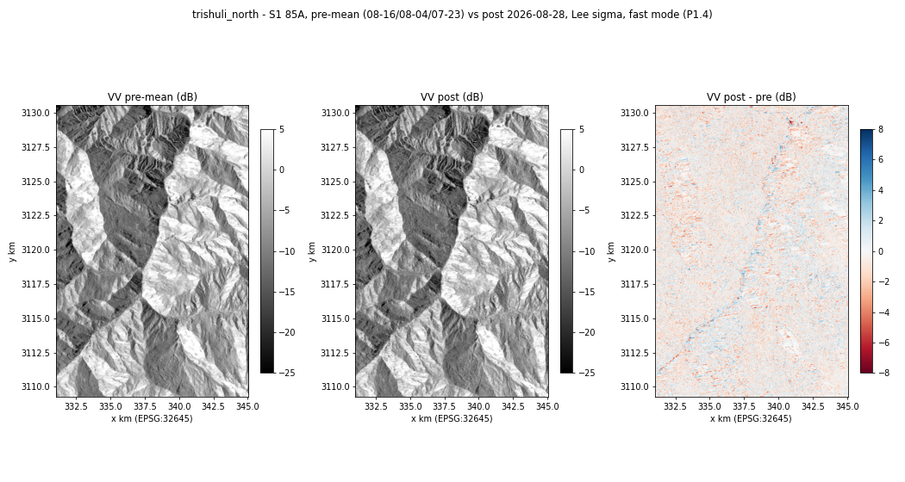

# P1.4 — `stage_s1` assembling the run

## What was built
`src/cutoff/data/s1_acquire.py`, `stage_s1(ctx)`:
1. Searches the CDSE STAC (event − 48 d → event + 12 d), runs `select_pairs` with the `configs/default.yaml` `s1`
   values, and writes `pairs.json` (search window, every scene seen, all candidates, the chosen set). On
   `NoValidPair` it writes `pairs.json` with `"error"` and re-raises; it never falls back to cross-track.
2. Picks the backend from `s1.backend_for_mode[ctx.mode]`: fast → sentinelhub, full → snap (P1.7), cached → cache.
3. Fetches the post + pre scenes. Each fetched (unfiltered) array is cached at
   `cache/s1/<scene.id>/<grid_hash>.tif` (4 bands VV, VH, LIA, dataMask; SNAP output goes to
   `<grid_hash>.snap.tif` because it is already filtered) and reused.
4. Sets dataMask = 0 → NaN.
5. Applies `lee_sigma` per scene per band (window/target/sigma from `s1.speckle`, 4.4 looks). This is skipped for
   SNAP output, which is already Lee-Sigma filtered.
6. Pre-mean = NaN-aware **linear** mean (`geo.sar.pre_mean_linear`, the same function P2 uses).
7. Writes `s1_pre_mean.tif`, `s1_post.tif` and `lia.tif` (post scene) via `geo.raster_io.write`.
8. Writes `shadow_layover.tif` = (LIA ≤ 0) | (LIA ≥ 90) on valid pixels (`s1.shadow_layover_lia_deg`).
9. Returns the `05_contracts.md` §4 dict.

Guards and supporting pieces:
- **Coverage check:** if < 80 % of the grid is valid in post or pre-mean, `ctx.warn("s1", "... x.x% ...")`.
- **Linear guard:** a backend array with negative or > 50 values raises `ValueError` *before* it can be cached, so
  dB is never written or cached.
- **`cached` mode** reads only the cache. The STAC search result is cached too (`cache/s1/stac/<key>.json`), so
  cached mode needs no network. If anything is absent it raises `CacheMiss`, whose message points to
  `scripts/cache_aoi.py`.
- Processing units per Sentinel Hub request go into `run.log` (`ctx.log` passed to the P1.3 backend).
- `scripts/cache_aoi.py --name --bbox --event [--mode fast] [--stages s1,terrain,s2] [--allow-cross-track]` runs the
  stages into `cache/<name>/`, validates each stage's outputs, and writes `stage_returns.json`. s2 is optional.

## Tests
```
python -m pytest tests/test_p1_stage_s1.py -q -p no:warnings         -> 7 passed
python -m pytest -m "not network and not gpu" -q -p no:warnings       -> all green
```
With a fake deterministic backend and the recorded STAC fixture:
- the stage writes contract-valid files (`validate_run_dir(..., keys=[s1_pre_mean, s1_post, lia, shadow_layover])`)
  and the expected return dict;
- a NaN block in pre scene 08-16 is filled by the other two pre scenes (linear mean 0.08);
- dB is never written: a dB backend raises before anything is written or cached, and the validator rejects dB
  written on disk;
- the low-coverage warning fires;
- the cache is written at `s1/<scene.id>/<grid_hash>.tif`; fast mode reuses it; cached mode needs neither search
  nor backend and gives identical files; cached mode without a cache raises `CacheMiss`;
- `NoValidPair` leaves `pairs.json` with the error.

## Network run on trishuli_north
- First attempt (2026-10-12): s1 blocked, no credentials (terrain ran; see the git history of this file).
- **Run on 2026-10-13 (credentials working): OK.**
  ```
  python scripts/cache_aoi.py --name trishuli_north --bbox 85.28,28.10,85.42,28.29 --event 2026-08-26T02:52:00Z
  [s1] OK in 72.0 s: {"s1_backend": "sentinelhub", "rel_orbit": 85, "orbit_direction": "ascending",
       "s1_post": {"id": "S1D_..._20260828T122141_..._C73B_COG", "datetime": "2026-08-28T12:21:41.762029Z"},
       "s1_pre": [08-16, 08-04, 07-23 (S1D)], "post_lag_hours": 57.495}
  [terrain] OK in 13.6 s
  [s2] OK in 0.4 s: {"s2_scenes": ["S2B_MSIL2A_20260827T045659_N0512_R119_T45RUM_20260827T084453"], "s2_clear_fraction": 0.3546}
  ```
  Every stage's outputs passed `validate_run_dir`.
- **First real-data finding (fixed in `p1/P1.8-real-runs`, see `P1_UPDATES_LOG.md` U8):** the first attempt stopped at the
  linear guard, because pre scene 08-16 has VV up to 113.7 linear on 20 of 2.98 M px (46° slopes facing the radar).
  The guard now detects dB by negative values; values > 50 are clipped at the contract maximum only when written.
- `run.log` excerpt (s1 stage of the successful run; `t` dropped, ids shortened):
  ```
{"stage": "s1", "event": "pair", "rel_orbit": 85, "direction": "ascending", "post": "S1D_IW_GRDH_1SDV_20260828T122141_...C73B_COG", "pre": ["20260816T122141", "20260804T122140", "20260723T122140"], "backend": "sentinelhub", "post_lag_hours": 57.49}
{"stage": "s1", "event": "cache_hit", "scene": "S1D_IW_GRDH_1SDV_20260828T122141_...C73B_COG"}
{"stage": "s1", "event": "cache_hit", "scene": "S1D_IW_GRDH_1SDV_20260816T122141_...B091_COG"}
{"stage": "s1", "event": "sentinelhub_request", "what": "S1D_IW_GRDH_1SDV_20260804T122140_...38EB_COG", "window": [0, 0, 2125, 1404], "processing_units": 45.52459716796874, "seconds": 15.99}
{"stage": "s1", "event": "sentinelhub_request", "what": "S1D_IW_GRDH_1SDV_20260723T122140_...2C7A_COG", "window": [0, 0, 2125, 1404], "processing_units": 45.52459716796874, "seconds": 14.03}
{"stage": "s1", "event": "written", "valid_post": 1.0, "valid_pre_mean": 1.0, "clipped_px": {"post": 0, "pre_mean": 20}, "shadow_layover_fraction": 0.0053, "backend_used": ["sentinelhub"]}
  ```
  (The post scene and 08-16 were already cached by the first attempt, so they show as `cache_hit`.)
- Result statistics: valid 100 % (post and pre-mean); shadow/layover 0.53 %; VV dB median pre −6.83 / post −7.03;
  ΔVV p1/p50/p99 = −3.99 / −0.14 / +3.30 dB; 4.8 % of pixels change by more than 3 dB.
- Quick-look (VV dB pre-mean, post, difference). The difference shows a narrow change signal along the Bhote Koshi –
  Trishuli valley floor, while the slopes stay near 0 dB. This is a visual note, not a measurement; detection is P2's stages.



## Deviations
- SNAP scenes are cached as `<grid_hash>.snap.tif` (not `<grid_hash>.tif`), so filtered SNAP output and unfiltered
  Sentinel Hub output are never mixed in one cache file. Cached mode reads either.
- The STAC search is cached as well. Without this, "`cached` mode reads only the cache" would be impossible.
