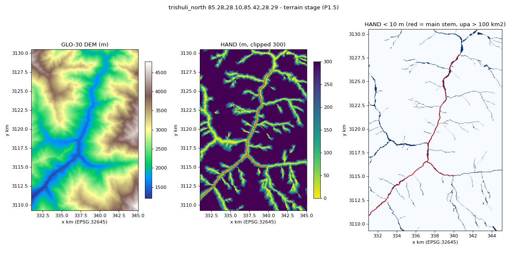

# P1.5 — Terrain stage

## What was built
- `src/cutoff/data/dem.py`
  - `glo30_tiles(bbox_wgs84)`: URLs of the 1°×1° GLO-30 tiles; a tile is named after its lower-left corner.
  - `dem_on_grid(grid, buffer_m=0)`: `/vsicurl/` reads of the public COGs, `rasterio.merge` over the needed window,
    then a bilinear warp onto the (buffered) grid. Returns `(dem float32 NaN-nodata, grid)`.
  - `stage_terrain(ctx)`:
    1. builds a 3 km-buffered grid (`dem.hand_buffer_m`, same 10 m alignment) and gets the DEM on it;
    2. computes HAND and D8 there with streams = `upstream_area("km2") > 1.0` (`dem.stream_upa_km2`), then crops;
    3. computes slope on the run grid (`np.gradient` on dem.tif at 10 m);
    4. writes `dem.tif`, `slope.tif`, `hand.tif` (NaN for −9999) and `flwdir_d8.tif` (uint8, 247 nodata) through
       `geo.raster_io.write`;
    5. returns `{"dem_tiles", "hand_stream_upa_km2"}`.
  - The buffered DEM is cached at `<cache_dir>/dem/<grid_hash>.tif`. `cached` mode reads only this file and raises
    `CacheMiss` if it is absent (needed for P1.4/P1.8 cached runs).
- `src/cutoff/geo/terrain.py`: `slope_degrees`, `hand_flowdir` (pyflwdir `from_dem` → `upstream_area` → `hand`,
  `to_array("d8")`), `buffered_grid`, `crop_to`.
- `src/cutoff/data/s1_acquire.py`: shared cache helpers `CacheMiss`, `grid_hash`, `cache_root`. `stage_s1` is still
  the stub (P1.4).

## Tests
```
python -m pytest tests/test_p1_terrain.py -q -p no:warnings -rs     -> 9 passed (incl. 1 network: live GLO-30 read)
```
- Tile names for (85.28, 27.95, 85.42, 28.29) = N27_00_E085_00 and N28_00_E085_00 (plus S/W naming).
- Slope of a 10 % plane = 5.711°.
- V-valley: HAND = 0 on the channel and exactly linear with distance.
- Tilted planes: every interior D8 code points to a lower cell (no interior pits).
- NaN DEM → NaN HAND / 247 D8.
- Buffer + crop are exact; the stage writes contract-valid files that equal the centre of the buffered DEM.
- `cached` mode reuses the cached DEM without fetching; `cached` mode without a cache raises `CacheMiss`.

### pyflwdir behaviour found (affects how the tests are written, not the method)
`pyflwdir.from_dem` (0.5.12) derives D8 from the Wang & Liu (2006) priority-flood order. A cell points to the
neighbour it was reached from, which is downhill but not necessarily the steepest neighbour: on an east-falling
plane it returns NE (equal 1 m drop). On the V-valley, hillslope cells drain diagonally, so HAND rises
(s + t)·10 m per pixel (2.1 m) instead of s·10 m (2.0 m); it is still exactly linear. The tests therefore check what
the plan states ("point downhill", "grows linearly") and not "points due east". Method unchanged (pyflwdir, as specified).

## Real run — trishuli_north (85.28,28.10,85.42,28.29)
Command (scratch script; builds a RunContext on `make_grid(bbox)` and calls `stage_terrain`, fast mode):
```
stage_terrain {'dem_tiles': ['.../Copernicus_DSM_COG_10_N28_00_E085_00_DEM.tif'], 'hand_stream_upa_km2': 1.0}  44.9 s  1404 x 2125 px
validate_run_dir OK
max upa in AOI km2 500.0   main-stem px 2271
HAND main stem p50/p90/p99 [0.0, 0.0, 0.0]   within 20 m [2.4, 10.8, 22.5]
HAND ridges (top 5% DEM) p1/p10/p50 [17.8, 202.7, 618.5]
HAND valid fraction 1.0   DEM range 1212 4780   slope p50/p90 [34.2, 47.7]
```
- **Bhote Koshi channel:** main stem (upstream area > 100 km² inside the buffered DEM) HAND = 0 m; pixels within
  20 m of it have median 2.4 m and p90 10.8 m. The check "HAND < 10 m along the channel" holds.
- **Ridges:** 90 % of the highest-5 % pixels have HAND > 200 m (median 619 m). The check "> 100 m on the ridges"
  holds. The low tail (p1 = 18 m) is high-altitude tributary valley floors, which are not ridges.
- Upstream area is limited to the buffered domain (500 km² max); the Bhote Koshi catchment in Tibet lies outside the
  3 km buffer. HAND only needs the nearest drainage, so this is fine with the 1 km² stream threshold.



## Limitation (for the report)
GLO-30 is a surface model (trees and buildings included), and at 30 m it smooths narrow gorges. That inflates HAND
near the riverbank, which is why the HAND corridor in `rules` is 60 m. Slope here has median 34°, so most of the AOI
is outside Kuro Siwo's slope distribution (D6 clip 0–15°).
