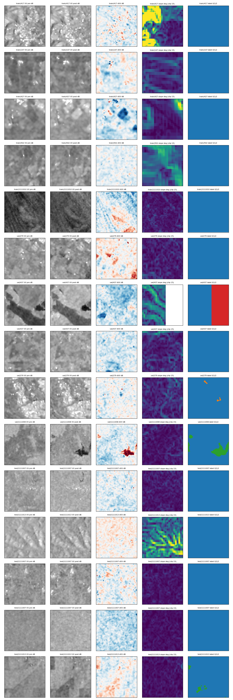

# P2.3 Kuro Siwo subset QA

| split | events | samples | with flood (>1 %) | mean flood frac | mean perm frac |
|---|---|---|---|---|---|
| train | 27 | 9114 | 0.44 | 0.102 | 0.030 |
| val | 6 | 1145 | 0.21 | 0.026 | 0.014 |
| test | 10 | 4250 | 0.30 | 0.052 | 0.021 |

Samples per event: ('test', '1111002'): 32, ('test', '1111007'): 1000, ('test', '1111013'): 1000, ('test', '205'): 130, ('test', '277'): 1000, ('test', '321'): 432, ('test', '411'): 149, ('test', '445'): 361, ('test', '561'): 69, ('test', '562'): 77, ('train', '1111004'): 450, ('train', '1111005'): 450, ('train', '1111006'): 438, ('train', '1111009'): 450, ('train', '1111010'): 450, ('train', '1111011'): 450, ('train', '118'): 302, ('train', '130'): 373, ('train', '147'): 376, ('train', '174'): 120, ('train', '267'): 396, ('train', '273'): 256, ('train', '275'): 450, ('train', '324'): 320, ('train', '417'): 328, ('train', '421'): 137, ('train', '427'): 450, ('train', '470'): 450, ('train', '492'): 377, ('train', '496'): 36, ('train', '497'): 415, ('train', '498'): 233, ('train', '502'): 418, ('train', '518'): 339, ('train', '554'): 119, ('train', '555'): 428, ('train', '567'): 103, ('val', '1111003'): 19, ('val', '1111008'): 123, ('val', '279'): 700, ('val', '437'): 169, ('val', '520'): 92, ('val', '559'): 42

Latitude range: -32.6 .. 58.6

